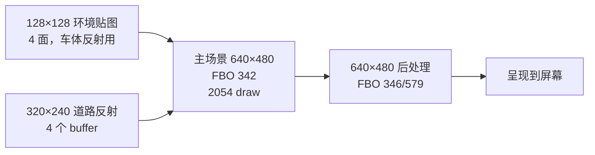

# 07 - RenderDoc 帧捕获分析：一帧画面的 draw 构成与合批空间

> 状态：分析完成（2026-10-06）。数据来源：RenderDoc v1.46 抓取的 `trace/nfs8.rdc`（PC 软件 GL llvmpipe，模拟真机 `RECOMP_GL_SKIP=320x240,128x128` 配置），转 XML 后用 `trace/` 下的脚本解析。
> 前置文档：[02 性能分析](02-R36S性能分析与优化方案.md)、[04 性能突破复盘](04-R36S性能突破复盘.md)、[06 PC 虚拟机卡顿](06-PC虚拟机卡顿根因与spin风暴.md)。
> 目标：回答「一帧比赛的 2000+ 个 draw 到底在画什么、能否合批」，把之前「GL 线程 139ms 是大头但原因未知」的空洞填上。

## 1. 结论速览

| 结论 | 证据 |
|---|---|
| 一帧 **2183 个 draw**，其中 **94%（2054）画在主后缓冲**上 | FBO 342 独占 2054 draw |
| **不是直接走屏幕**，是**多 pass 延迟渲染**：环境贴图 → 反射 → 主场景 → 后处理 | 11 个 FBO，10 个是 render-to-texture 中间 buffer |
| 最大单 shader **program 156 独占 1017 draw（47%）**，但 shader 极简单（单纹理 × 漫反射色） | frag shader 只有 1 个 `texture(t0)` |
| **合批空间巨大**：1017 draw 只用 132 张纹理，前 3 张就占 314 draw | program 156 纹理分布极度头重 |
| **合批的障碍是「按物体顺序提交」而非「按纹理排序」** | Xbox D3D 提交习惯被静态重编译原样保留 |

## 2. 一帧画面的 pass 结构

`fbo_analysis.py` 从 XML 还原了 FBO → 挂载纹理 → 尺寸的完整图谱：

| FBO | 挂载纹理 | 尺寸 | 性质 | draw 数 |
|---|---|---|---|---|
| **342** | 340 | **640×480** | **主后缓冲（最终画面）** | **2054** |
| 346 | 344 | 640×480 | 后处理中间结果 | 1 |
| 579 | 577 | 640×480 | 后处理中间结果 | 25 |
| 235 | 233 | 320×240 | 道路反射 / 降采样 | 2 |
| 238 | 236 | 320×240 | 道路反射 | 2 |
| 260 | 258 | 320×240 | 后处理 | 1 |
| 300 | 298 | 320×240 | 后处理 | 1 |
| 402 | 400 | 128×128 | 环境贴图面（车体反射） | 92 |
| 448 | 446 | 128×128 | 环境贴图面 | 7 |
| 464 | 462 | 128×128 | 环境贴图面 | 7 |
| 469 | 467 | 128×128 | 环境贴图面 | — |



**要点**：`RECOMP_GL_SKIP=320x240,128x128` 已经把反射/环境贴图 pass 的 draw 数砍到极低（FBO 402 只剩 92），但**中间 buffer 本身仍在创建、清空、切换**（FBO 切换 15 次）。真正的大头是主场景 FBO 342 的 2054 draw。

## 3. 每个 draw 在干什么（shader 视角）

`deep_prog2.py` 提取了全部 21 个 program 的 shader 源码。draw 数前 6 的 program：

| program | draw 数 | 占比 | shader 特征 |
|---|---|---|---|
| **156** | **1017** | **47%** | 标准场景材质：单纹理 × 漫反射色 |
| 153 | 320 | 15% | 同类，另一套 combine |
| 159 | 190 | 9% | |
| 141 | 181 | 8% | |
| 171 | 175 | 8% | |
| 177 | 81 | 4% | |

**program 156 的 frag shader 核心**（完整源码在 §5）：

```glsl
vec4 T0 = texture(t0, tc0 * u_tscale[0]);   // 只采样 1 个纹理
vec3 cAB = cA * cB;                          // 纹理色 × 漫反射色
R0.rgb = cAB;
```

**关键判断**：program 156 就是「最普通的不透明场景几何」——道路、建筑、车身的默认材质。**它贵不是因为 shader 复杂，而是因为同一份简单材质被拆成了 1017 次独立 draw**。

## 4. 合批空间的量化证据

`prog_tex_fixed.py` 跟踪 4 个 texture unit 的绑定，统计每个 program 用了多少张 unit0 纹理：

| program | draw 数 | unit0 纹理数 | draw/纹理比 |
|---|---|---|---|
| **156** | 1017 | **132** | 7.7 |
| 153 | 320 | 82 | 3.9 |
| 159 | 190 | 42 | 4.5 |
| 141 | 181 | 19 | 9.5 |
| 171 | 175 | 13 | 13.5 |

**program 156 的纹理分布极度头重**（`prog_tex_fixed.py`）：

| 纹理 | draw 数 | 纹理尺寸/格式 |
|---|---|---|
| 411 | **111** | 128×32 DXT1 |
| 412 | **109** | 256×64 DXT1 |
| 413 | **94** | 128×64 DXT1 |
| 355 | 29 | 64×64 DXT1 |
| 478 | 29 | 32×32 DXT1 |
| 460 | 29 | 64×64 RGBA8 |
| … 其余 126 张 | 1–28 各 | 长尾 |

### 合批的判断

1. **前 3 张纹理（411/412/413）就占 314 draw（31%）**——这三张很可能是道路/路面的大贴图，被按「每段路面一个 draw」拆开提交。
2. **132 张纹理、1017 draw，平均每张纹理只画 7.7 个 draw**——说明 NFSU2 的 draw 是「按物体/chunk 顺序」提交，不是「按材质排序」。
3. **合批的 ROI 很高**：如果能按纹理排序 + 合并同纹理的 draw，主场景 2054 draw 理论上能压到几百。但这是**渲染器层的改动**（缓存 pushbuffer → 重排序 → 合批），不是改游戏代码。

## 5. 真机 vs PC 的关键差异（影响合批决策）

热点纹理全是 **S3TC DXT1/DXT3**：

```
411: 128×32  DXT1    412: 256×64  DXT1    413: 128×64  DXT1
461: 32×256  DXT3    415: 32×128  DXT1    ...
```

但**真机 Mali-G31 不支持 S3TC**（AGENT.md §3.1），所以真机上这些纹理走 **CPU 解码转 RGBA8** 再上传。这意味着：

| 环境 | 纹理格式 | 上传开销 |
|---|---|---|
| PC（llvmpipe + Mesa） | DXT 直传 | 低 |
| **真机（Mali）** | DXT → CPU 解码 → RGBA8 | **高**（加载期 + 比赛中途卡顿） |

这印证了 docs/02 §3.6 的「会话累计上传 91.6MB」——真机的纹理上传是 DXT 解码造成的，和合批无关，但要单独优化（ASTC 离线转换，docs/02 §7.3 / reVC docs/07 路线）。

## 6. 下一步优化路线（按 ROI 排序）

| # | 方向 | 依据 | 预期收益 | 工作量 |
|---|---|---|---|---|
| 1 | ~~降 `RECOMP_GL_SKIP_MIN` 16→8~~ ✅已验证 | §9：只砍 ~50 draw（-5%），真机无体感 | 极小，已排除 | 一行配置 |
| 2 | **主场景按纹理排序 + 合批**（program 156 的 1017 draw） | §4：132 纹理 1017 draw，前 3 纹理占 314 | 主场景 draw 数可减半以上 | 中（渲染器层改动） |
| 3 | **DXT 离线转 ASTC** | §5：真机 Mali 无 S3TC，CPU 解码是卡顿源 | 消除纹理上传卡顿 | 中-大（reVC docs/07 路线） |
| 4 | 减少中间 buffer 的创建/清空 | §2：10 个 render-to-texture 中间 buffer | 每帧省 FBO 切换 + clear | 中 |

**#1 已验证收益极小（§9），真正要攻的是 #2**：主场景按纹理排序合批（program 156 的 ~1100 draw）。#3 解决的是卡顿不是稳态帧率。

## 7. 复现方法

```bash
# 1. 抓帧（RenderDoc UI 或命令行，环境变量见 §8）
# 2. 转 XML
renderdoccmd convert -f nfs8.rdc -o nfs8.xml -c xml
# 3. 解析（脚本在 trace/ 目录）
python3 trace/parse_rdc.py nfs8.xml        # draw 按 FBO/program 分布
python3 trace/fbo_analysis.py nfs8.xml     # FBO → 纹理 → 尺寸
python3 trace/deep_prog2.py nfs8.xml       # 每个 program 的 shader 源码
python3 trace/prog_tex_fixed.py nfs8.xml   # program → unit0 纹理分布
python3 trace/tex_detail.py nfs8.xml       # 热点纹理尺寸/格式
```

## 8. 抓帧时的环境变量（软件 GL，模拟真机）

```
NFSU2_GAME_DIR=/home/vifex/workpath/r36s/PortMaster/nfsu2-sw/build/game
NFSU2_SAVE_DIR=/home/vifex/workpath/r36s/PortMaster/nfsu2-sw/build/save-linux
RECOMP_FPS_LOG=1
RECOMP_SKIP_INTRO=1
RECOMP_GL_SKIP=320x240,128x128
RECOMP_PAD_SCRIPT=3000:a:200,5000:a:200,7000:a:200,9000:a:200,11000:a:200,13000:a:200,15000:start:300,25000:start:300,35000:start:300,45000:a:200,55000:a:200,65000:start:300,75000:a:200,85000:a:200,95000:a:200
LIBGL_ALWAYS_SOFTWARE=1
GALLIUM_DRIVER=llvmpipe
LP_NUM_THREADS=8
RECOMP_KNOB_SPIN_WAKE_EVERY=64
RECOMP_KNOB_SPIN_YIELD_IDLE=1
```

`RECOMP_PAD_SCRIPT` 从第一次读手柄算起约 95 秒进比赛；进比赛后按 F12 抓帧。

## 9. SKIP_MIN=8 验证（2026-10-06，二次抓帧）

为验证「降 `RECOMP_GL_SKIP_MIN` 16→8 砍环境贴图残党」是否有效，在同一 PC 环境做了 A/B（软件 GL，真机同款 `RECOMP_GL_SKIP=320x240,128x128`），两次都在**起跑线**抓帧。

### 数据

| 指标 | SKIP_MIN=16（默认） | SKIP_MIN=8 | 差异 |
|---|---|---|---|
| 总 draw | 2400 | 2280 | **-120（-5%）** |
| 640×480（主场景） | 2239 | 2169 | -70 |
| 128×128（环境贴图） | 156 | 106 | **-50（-32%）** |
| 320×240 | 5 | 5 | 0 |
| program 分布 | 156 独占 1117 | 156 独占 1090 | 基本一致，无后处理丢失 |

### 结论

1. **SKIP_MIN=8 有效但收益极小**：只额外砍掉 ~50 个 128×128 环境贴图 draw（156→106），占总 draw 的 -5%。
2. **没有误伤后处理**：program 分布两个 capture 基本一致（后处理 pass 的 draw 数都 ≥16，不受 SKIP_MIN=8 影响）。
3. **真机体感「没啥感觉」完全合理**：-5% 的 draw ≈ 每帧省 ~9ms（120 draw × ~75µs/draw，来自 docs/04 §8 的 per-draw 成本），在 123ms/帧里占比 <7%，且 GL 线程本来就有 27% 时间在 `queue empty` 等 executor，这点省出来的时间被等待吸收了。

### 教训：抓帧对比要控制「发车位置」

两次都在起跑线抓，但**发车位置不同**：镜头外的车不渲染（视锥剔除），导致两帧的 draw 数天然有差异。具体表现：

- **nfs8 帧**（SKIP_MIN=16）：program 156 = 1117，program 153 = 342，program 141 = 252；
- **nfs8_skip8 帧**（SKIP_MIN=8）：program 156 = 1090，program 153 = 357，program 141 = 79（**骤降**）。

program 141 从 252 → 79 的差异远超 SKIP_MIN 能解释的范围，说明**两帧看到的车辆/物体数量不同**（发车位置不同 → 视锥内车流不同）。所以「-120 draw」里有多少是 SKIP_MIN 的功劳、有多少是场景差异，**无法严格分离**。

**教训**：RenderDoc 抓帧做 A/B 对比时，必须**锁定同一帧**（同一发车位置、同一赛道、同一镜头角度）。发车位置、车流、视角任何一项变了，draw 数都会漂移，SKIP_MIN 这种小改动（预期只差 ~50 draw）会被场景噪声（±200 draw）淹没。

### 下一步修正方向

- 若继续用 PC 抓帧做 A/B，改用**固定场景**（如停在起跑线不动、或固定赛道回放），让两帧的可视内容一致。
- 更可靠的验证手段是**真机日志**的 `[GL] skipped N draws/frame (RECOMP_GL_SKIP)` —— 这个数字直接反映 SKIP_MIN 砍了多少，不受场景漂移影响。


## 10. 勘误与补充（2026-10-07，用 `trace/rdc_frame.py` 重新解析 `nfs8.xml`）

上面 §1–§6 是初步分析。按 draw 逐个跟踪状态后重新核对，有几处要更正：

| 原结论 | 更正 |
|---|---|
| 一帧 2183 个 draw，program 156 是 1017 个 | 同一个文件实测 **2400 个 draw**，program 156 是 **1117 个**（§9 的数字是对的，§1–§4 的数字来自更早的解析版本） |
| program 156 很简单，「只采样 1 张纹理」 | 片元 shader 确实简单，但**顶点 shader 是翻译过来的 NV2A 顶点程序，有 24 条以上指令**（光照、雾、纹理坐标变换）。在 Mali 上，顶点开销不能忽略 |
| 合批潜力很大：「2054 个 draw 能压到几百个」 | 相邻 draw 之间：**2149/2399 次要上传顶点常量**（每个物体有自己的世界矩阵，`c[0..191]` 中每次平均变 10 行），**560 次有状态切换**，只有 **250 次**完全没变化。整帧共 459 个不同的（fbo, program, 4 纹理, blend, depth）组合。只合并相邻、状态相同的 draw，上限约 **2400 → 2150**；要真正合批，得把每个物体的矩阵塞进 instance 数据或者在 CPU 上预变换。这属于渲染器的重构，不是简单排序就能做到 |
| 「真机纹理走 CPU 解码，所以上传开销高」 | 方向对，但和稳态帧率关系不大。纹理有缓存，稳态时不重复上传。这一帧 74% 的 draw 用的是 DXT 纹理 |
| 「SKIP_MIN=8 每帧省约 9ms（120 个 draw × 75µs）」 | 75µs/draw 是早期没有优化时的数字。docs/04 之后，真机 blob 每个 draw 的固定开销约 15–25µs，`glDrawRangeElements` 已经不再扫描索引。另外 §9 自己也承认这 120 个 draw 里大部分是场景差异 |

补充发现：
- **PC（Mesa）上，每个 draw 都整块上传 3KB 顶点常量**：`vpc_rows` 优化依赖 `c[191]` 的 location 等于 `u_c + 191`，Mesa 不满足这个条件，就退回到整块上传（这一帧共 6.5MB uniform）。真机 Mali 是否满足还没验证。如果也不满足，就有一个确定的优化点：给 `c` 改成用 UBO，或者按行取 location 再分别上传。
- **每帧的 GL 调用约 8 次/draw**，主要是 `glVertexAttribPointer`（约 3 次/draw）和 `glUnmapBuffer`（约 2 次/draw）。注意 PC 上没开持久映射，真机开了持久映射，数字不一样（docs/02 §11）。
- 后续方向见 [08 画质开关](08-画质开关定位.md)：与其在 GL 层合批或跳过，不如关掉游戏自己的画质开关，这样主线程也能省下来。
