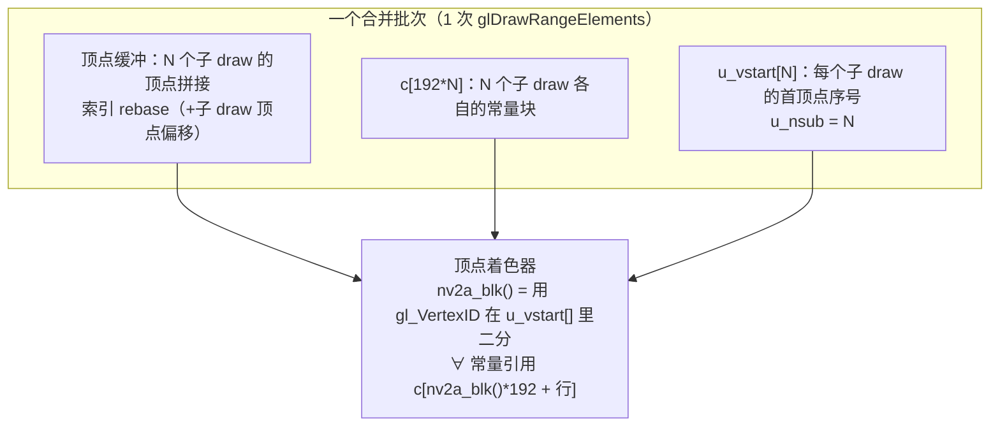

# 09 - 碎片 draw 合并尝试：PC 成功、真机失败

> 日期：2026-10-08。前置文档：[07 RenderDoc 帧捕获分析](07-RenderDoc帧捕获分析.md)（碎片 draw 的定量证据）、[08 画质开关定位](08-画质开关定位.md)。
> 状态：**已回退（代码从 `xboxrecomp/src/nv2a_gl/` 删除，提交 6dbb731 的 revert）**。PC 验证通过（draw -76%），真机失败（帧率 7-13 → 0.2-2.5）。本文档保留作失败分析，重做见 docs/10。

## 1. 背景与目标

docs/07 定量证明：一帧比赛 **2373 个 draw**，其中 **1490 个是「碎片 draw」（索引 < 50）**，占 GL 线程 draw CPU 时间的 54%。这些碎片是**树、建筑、车被一个 quad 一个 quad 拼出来的**（NFSU2 原版 Xbox 的提交方式——Xbox GPU 硬件消费 pushbuffer，提交免费；静态重编译后每个 draw 变成一次真实的 `glDrawElements`）。

**合并空间**（docs/07 数据）：2373 → 556 个可合并组（**-77%**），且**相邻同纹理的 draw 本来就连续**（不需重排序顶点）。

**目标**：把相邻的、同 program/纹理/状态的碎片 draw 合并成一次 `glDrawRangeElements`。

## 2. 方案设计

### 2.1 核心问题：每个 draw 有自己的顶点常量

相邻同纹理 draw 之间有 **89% 的 c[192] 不同**（每 draw 一个模型矩阵，改 8-16 行，主要集中在 c[96..109]）。

### 2.2 方案：per-draw 常量块（`nv2a_blk()` 从 gl_VertexID 选块）



- **顶点**：拼接；**索引**：rebase（`idx[i] + subdraw_vertex_start`）。
- **常量**：子 draw 的 `c[192]` 存进块 `c[blk*192 ..]`。
- **shader**：`nv2a_blk()` 用 `gl_VertexID` 与 `u_vstart[]` 比较，求出当前顶点属于哪个块；所有 `c[ci]` 引用改写成 `c[nv2a_blk()*192 + ci]`（`gl_vsh.c` 的 `src()`，`writes_consts` 的 `cl[]` 初值同理）。
- **批量上限**：`NV2A_MERGE_MAX=16`，但**运行期按设备的 `GL_MAX_VERTEX_UNIFORM_VECTORS` 自适应**（`mg_init()`）：`blocks = (vectors - 32) / 192`，取 min(16)。Mali 报告 1024 → **5 块**；桌面 GL 报告 4096 → 16 块。

### 2.3 匹配条件（不满足就 flush 当前批次）

`mg_match()`（`nv2a_gl.c:1953`）要求全部一致：program、4 个纹理地址、GL 状态哈希（`mg_state_sig`，见 §2.4）、prim、surface（color_va + zeta_va）、顶点布局（`attr_present`/`attr_direct`、stride、属性偏移），且顶点必须是**单一连续 run**（`vertex_runs() == 1`），且属性无 `conv`（非 direct）。

### 2.4 状态哈希 `mg_state_sig()`

哈希 `0x260..0x3A4`（combiner/blend/depth/stencil/cull/colormask）、`0x1B00..0x1C00`（纹理 stage 的 filt/ctl）、`0x1E00..0x1E80`（final combiner/tex-gen/fog），**排除顶点常量**（它们按块逐 draw 走）。

## 3. 代码位置（`xboxrecomp/src/nv2a_gl/`）

| 文件 | 内容 |
|---|---|
| `nv2a_gl.c:108-133` | `mg_init()`：读 `RECOMP_GL_MERGE`、查 uniform 预算、设 `s_mg_max`/`nv2a_merge_max` |
| `nv2a_gl.c:1330` | `mg_init()` 在 `prog_cache_prewarm()` **之前**调用（关键，见 §4.2 的 bug）|
| `nv2a_gl.c:1881-2135` | 合并主体：`Mg` 结构、`mg_match`、`mg_begin`、`mg_append`、`mg_flush` |
| `nv2a_gl.c:2417` | `gl_draw_raw` 里 `mg_init()` |
| `nv2a_gl.c:2478-2500` | 合并**快速路径**：prog_get 之后、任何 GL 调用之前，兼容就直接 `mg_append`（零 GL 调用） |
| `nv2a_gl.c:2530+` | 非合并路径：复位 `u_nsub=0`（`p->nsub_set` 标志），避免复用合并 program 时取错块 |
| `nv2a_gl.c:2700`、`2903` | flush 点：`gl_clear`、`gl_flip` 前必须 flush |
| `gl_vsh.h:22-27` | `nv2a_shader_merge`、`nv2a_merge_max`、`NV2A_MERGE_MAX` |
| `gl_vsh.c:90-105` | `src()`：常量引用加 `nv2a_blk()*192 +` 前缀 |
| `gl_vsh.c:355-410` | `merge_augment()` + `nv2a_gl_vsh_prelude()`：桌面/ES 两条路径都拼装 `c[192*N]` + `u_vstart[N]` + `nv2a_blk()` |

诊断输出（每 300 draw）：`[GL] merge: N draws -> M GL draws (K merged, S sub/batch, B bad-prim)`。

## 4. PC 验证结果（成功）

环境：PC 软件 GL（llvmpipe），`RECOMP_GL_MERGE=1`。

| 指标 | 基线 | 合并 | 变化 |
|---|---|---|---|
| 总 draw（RenderDoc 抓帧）| 2373 | **561** | **-76%** |
| 碎片 draw（≤49 索引）| 1490 | **181** | **-88%** |
| program 93（最多碎片）| 1185 | **218** | -82% |
| 平均 sub/batch | — | **4.2** | — |
| fps（llvmpipe）| ~23 | ~23 | **无变化** |

**画面正确**：BMP 转储人工确认无破损（车辆、建筑、灯光、小地图、速度表全部正常）。

**注**：PC 上 fps 没提升，因为 llvmpipe 是软件光栅化——`duration` 主要花在**光栅化**而非 draw 提交。真机 Mali 的光栅化是 GPU 做的，draw 提交才是瓶颈，所以真机才是关键验证。

### 4.1 合并后的 draw 构成（RenderDoc 复核）

`1-9 索引` 的 draw 从 500 降到 48；`300-999 索引` 的从 70 降到 34——合并把大量小 draw 拼成了中等大小的 draw。

## 5. 真机结果（失败）

环境：R36S（RK3326 4×Cortex-A35 + Mali-G31，GLES 3.0），`env.txt` 加 `RECOMP_GL_MERGE=1`，清空 `progcache.bin`。

| 指标 | 基线（merge 关）| 合并 | 变化 |
|---|---|---|---|
| fps（比赛）| **7-13** | **0.2-2.5** | **灾难性变慢** |
| GL draw | ~2400 | ~1000-1100 | 有降 |
| **平均 sub/batch** | — | **1.45** | 远低于 PC 的 4.2 |

真机日志：
```
[GL] merge: 1024 vertex uniform vectors -> 5 blocks (on)
[GL] draw merging on (RECOMP_GL_MERGE)
[GL] merge: 1200 draws -> 822 GL draws (377 merged, 1 sub/batch, 0 bad-prim)
```
`bad-prim = 0`（prim 转换不是原因）。

## 6. 失败根因分析

### 6.1 顶点着色器变慢（**主因**）

`nv2a_blk()` 在**每个顶点**上执行：
```glsl
int b = 0;
for (int i = 1; i < u_nsub; i++)     // 每顶点循环 N 次
    if (gl_VertexID >= u_vstart[i]) b = i;
return b;
```
再叠加 `c[nv2a_blk()*192 + ci]` —— **动态索引 uniform 数组**。Mali 对动态索引 uniform 的支持通常很差：可能退化为「逐顶点重新加载整个 uniform 数组」或强制循环展开，代价高。2400 个 draw 的全部顶点都要走这条路。

### 6.2 合并率低（真机 1.45 vs PC 4.2）

可能原因（未逐一验证）：
- 真机 `RECOMP_GL_SKIP` 跳过的 draw 与 PC 时机不同，打乱了相邻性；
- `s_mg_max=5`（Mali）比 16（桌面）小，更早 flush；
- 真机/PC 的 pushbuffer 序列本身不同（**同一场景不同帧**，或 CPU 架构差异导致 lifted 代码行为微差）。

### 6.3 CPU 开销放大（弱 CPU）

`mg_match()` 每次 draw 都调 `vertex_runs()`（遍历 16 个属性算字节范围）；`mg_append()` 每次 `memcpy` 顶点 + 可能 `realloc`。合并率只有 1.45 时，**大部分 draw 白做了 match 检查却没合并成功**，纯亏 CPU。A35 单核性能很弱，这些开销被放大。

### 6.4 综合

**三重打击**：顶点着色器变慢（6.1）+ 合并率低省不下（6.2）+ 匹配开销白花（6.3），净效果是「更慢」。

## 7. 代码现状与回退

- 改动**未提交**（`gl_vsh.c` +72/-x、`gl_vsh.h` +12、`nv2a_gl.c` +363）。
- **默认关闭**：不设 `RECOMP_GL_MERGE` 时 `s_merge=0`，行为和原来完全一致（不会有 shader 差异，因为 `nv2a_shader_merge=0` 时 prelude 不拼装）。
- **真机回退**：删掉 `/roms/ports/nfs8/env.txt` 里的 `RECOMP_GL_MERGE=1`，并删 `progcache.bin`（否则可能复用合并版 shader 缓存）。

```bash
sshpass -p ark ssh ark@192.168.10.241 \
  'cd /roms/ports/nfs8 && sed -i "/RECOMP_GL_MERGE/d" env.txt && rm -f progcache.bin game/progcache.bin'
```

### 7.1 实现过程中修掉的 bug（供参考）

| Bug | 现象 | 修复 |
|---|---|---|
| `mg_init()` 晚于 `prog_cache_prewarm()` | 预编译了非合并 shader，运行时复用 → **画面破损/爆炸** | `mg_init()` 提到 prewarm 前（`nv2a_gl.c:1330`）|
| GLES 路径没拼 merge prelude | 真机 `nv2a_blk` 未定义 → **全部 shader 编译失败 → 黑屏** | 抽 `merge_augment()`，桌面/ES 共用（`gl_vsh.c`）|
| `nv2a_blk()*192u`（int×uint）| GLSL 3.30 报错 | 改成 `192`（int）|
| 非合并 draw 不复位 `u_nsub` | 合并后再画单个 draw 取错块 → 破损 | per-program `nsub_set` 标志，非合并路径复位 0 |
| `writes_consts` 的 `cl[i]=c[i]` 只拷块 0 | 写常量的顶点程序在合并时用错块 | 改成 `c[nv2a_blk()*192+i]` |

## 8. 后续建议（按可行性排序）

| # | 方向 | 说明 | 风险/成本 |
|---|---|---|---|
| A | **放弃 shader 合并，只合并「c[] 完全相同」的相邻 draw** | docs/07 数据：11% 的相邻对 c[] 相同。纯 CPU 合并顶点/索引，**不改编 shader** | 低风险，收益小（~200 draw）|
| B | **用 CPU 顶点预变换替代 shader 块索引** | 合并时把每个子 draw 的顶点乘上它的模型矩阵，烘成世界坐标；合并后 c[] 统一，shader 不用改 | 中；CPU 变换开销（顶点数 × 矩阵乘）在 A35 上要实测 |
| C | **UBO 存 per-draw 常量** | GLES 3.0 支持 UBO（`MAX_UNIFORM_BLOCK_SIZE` 通常 16KB+）。把 `c[]` 放进 UBO 数组 `ub_c[block]`，shader 里按 block 索引 | 中；仍需 `nv2a_blk()`，但 UBO 的动态索引可能比 plain uniform 数组快（待验证）|
| D | **换方向：不优化 draw 提交** | 真机瓶颈可能是 guest 主线程（docs/04 §8 的 GIL/executor），draw 合并不触及它 | 需重新 profile |
| E | **只对特定 program/submit 段做合并** | 比如只合并连续 20+ 个同 (prog,tex) 的段（docs/07 里最长连续段 128），减少 match 开销 | 低-中 |

**教训**：PC（llvmpipe）上「draw 数降 76%」**不能推断真机收益**——llvmpipe 的瓶颈在软件光栅化，Mali 的瓶颈在别的环节，而且**顶点着色器的改动在硬件上代价完全不同**（动态 uniform 索引）。任何改 shader 的优化都必须**先在真机上小规模验证**，不要只看 PC。

## 9. 复现命令

```bash
# PC（合并，llvmpipe）
cd PortMaster/nfsu2-sw
rm -f progcache.bin build/live/progcache.bin
bash tools/pc/run.sh mg_test 100 RECOMP_GL_MERGE=1     # BMP 转储在 build/mg_test/

# RenderDoc 抓帧
bash tools/pc/rdoc.sh mg RECOMP_GL_MERGE=1             # F12，存 trace/mg_frameN.rdc

# 真机（当前 merge 开启，很卡——先回退见 §7）
export R36S_HOST=192.168.10.241
python3 r36s/autotest.py --skip-deploy
```
